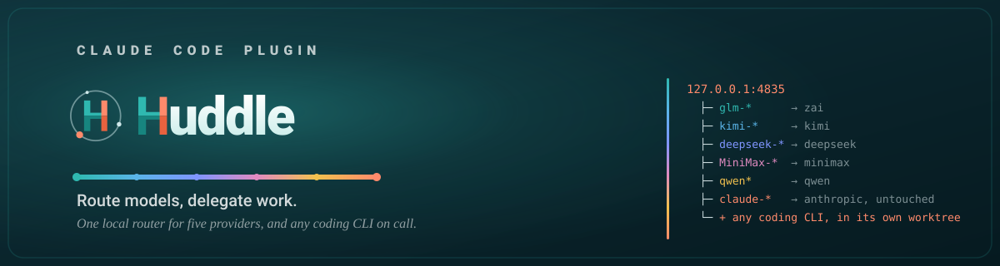
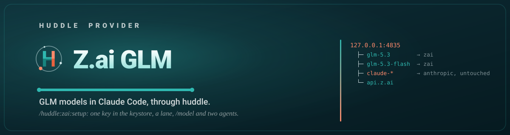
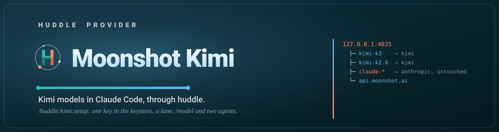
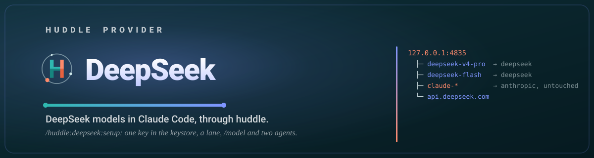
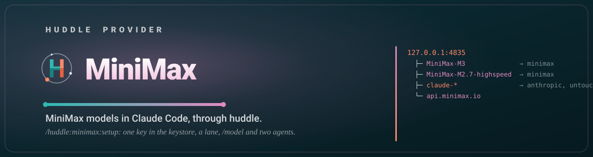
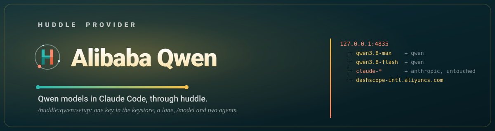

<p align="center">
  
</p>

<p align="center">
  <a href="https://www.gnu.org/licenses/gpl-3.0"></a>
  <a href="https://www.rust-lang.org/"></a>
  <a href="https://code.claude.com/docs/en/plugins"></a>
  <a href="https://github.com/MuhmdRaouf/huddle/actions/workflows/ci.yml"></a>
</p>

<p align="center">Built with ❤️ for the Claude Code community.</p>

<p align="center">
  <a href="https://github.com/sponsors/MuhmdRaouf"></a>&nbsp;&nbsp;<a href="https://buymeacoffee.com/muhmdraouf"></a>
</p>

Claude Code sends every model request to Anthropic. A model from Z.ai, Moonshot,
DeepSeek, MiniMax or Alibaba needs its own endpoint and its own key. A task for
another coding CLI needs its own terminal, and its result has to come back by hand.

huddle is a Claude Code plugin and one Rust binary with two jobs:

- **Routing.** A local router sends each model request to the provider the model
  belongs to, and every `claude-*` request to Anthropic untouched.
- **Delegation.** A task goes to another coding CLI, working in your folder or the one `--dir` names.
  Claude reads the diff and the report, then accepts or returns it.

## Quick start

1. Add the marketplace and install the plugin in Claude Code:

   ```text
   /plugin marketplace add MuhmdRaouf/huddle
   /plugin install huddle@muhmdraouf
   ```

2. Run `/huddle:setup`.
3. Restart Claude Code once, so it reads the proxy settings.
4. Run `/huddle:zai:setup`. A key page opens in your browser: paste your Z.ai key.
5. Pick a GLM model in `/model`, or delegate a task:

   ```text
   /huddle:run opencode "add a test for the parser"
   ```

## Installation

huddle runs on macOS and Linux, on amd64 and arm64. There is no native Windows
build; on Windows, run Claude Code and huddle inside WSL.

### What `/huddle:setup` changes

1. The `huddle` binary, in `~/.local/share/huddle/bin/`.
2. A `huddle` link in `~/.local/bin/`, so `huddle` works in any terminal whose
   `PATH` has that folder. Setup says so when it does not.
3. The router, started on `127.0.0.1:4835`, and the local CA.
4. Claude Code's `settings.json`: the proxy and CA settings.

`huddle uninstall` undoes every one of them and restores `settings.json` byte for byte.

### Update

1. Update the plugin: `/plugin marketplace update muhmdraouf`, then
   `/reload-plugins`.
2. Run `/huddle:update`. It installs the binary of the version the plugin
   carries: it downloads the release, checks it against `SHA256SUMS`, switches
   the `huddle` link and hands the running router to the new binary without
   dropping a connection.
3. It prints `huddle 0.0.2 → 0.0.3`, or `huddle 0.0.3 is the latest`. A failed
   checksum leaves the old binary in place. It does not touch `settings.json`.

### Uninstall

1. `/huddle:<p>:remove` for each provider you set up.
2. `huddle uninstall`.
3. `/plugin uninstall huddle@muhmdraouf`.

### From 0.0.5 to 0.0.6

The five providers are part of the `huddle` plugin. Remove the five provider
plugins (zai, kimi, deepseek, minimax and qwen) in `/plugin`, update huddle, and
run `/huddle:setup` again: it names each old plugin it finds. Then use
`/huddle:<p>:setup`; an old key in the keystore is kept.

## Providers

<p align="center">
  
  
  
  
  
</p>

| Provider | Models | Commands |
|---|---|---|
| Z.ai GLM | `glm-5.3`, `glm-5.3-flash` | `/huddle:zai:setup`, `/huddle:zai:remove`, `/huddle:zai:usage` |
| Moonshot Kimi | `kimi-k3`, `kimi-k2.6` | `/huddle:kimi:setup`, `/huddle:kimi:remove`, `/huddle:kimi:usage` |
| DeepSeek | `deepseek-v4-pro`, `deepseek-flash` | `/huddle:deepseek:setup`, `/huddle:deepseek:remove`, `/huddle:deepseek:usage` |
| MiniMax | `MiniMax-M3`, `MiniMax-M2.7-highspeed` | `/huddle:minimax:setup`, `/huddle:minimax:remove`, `/huddle:minimax:usage` |
| Alibaba Qwen | `qwen3.8-max`, `qwen3.8-flash` | `/huddle:qwen:setup`, `/huddle:qwen:remove`, `/huddle:qwen:usage` |

`setup` checks the key with the provider, enables the lane, starts the router and
adds the models to `/model`. `remove` takes the lane, the `/model` entries, the
agents and the key back out; the other providers keep serving. `usage` shows
requests, tokens and estimated cost per model, for today and the last 7 and 30 days.

### How a key gets in

- **From Claude Code:** `/huddle:<p>:setup` opens a one-time key page on
  `127.0.0.1`. Paste the key there. A key the provider refuses is never stored,
  and never replaces a stored one.
- **From a terminal:** `huddle provider <p>` walks you through it. It asks for the
  key with the echo off.
- **From a script:** set `<P>_API_KEY` (`ZAI_API_KEY`, `KIMI_API_KEY`,
  `DEEPSEEK_API_KEY`, `MINIMAX_API_KEY`, `QWEN_API_KEY`), or pipe the key into
  `huddle provider <p> key`.

A key never travels in a chat, an argument or an output line.

### Where keys live

In the OS keystore: the macOS Keychain, or the Secret Service on Linux.

### Agents

Setting a provider up writes its two agents into `~/.claude/agents/`, named by
the bare model, for example `glm-5.3`. Claude can hand work to that model by
name. A provider you never set up shows no agents, and `remove` deletes them.

## Delegation

Hand a task to another coding CLI: `claude`, `codex`, `opencode`, `omp`, `pi`,
`zcode` and the rest of the harness table. `/huddle:setup` with no argument
lists every harness and whether it is ready; the dashboard's Harnesses page
shows the same table.

1. `/huddle:run <harness> <task>` starts the harness in your current folder, or
   the folder `--dir <path>` names. Huddle makes no worktree: pass a worktree's
   path with `--dir` when you want isolation. It waits for the
   result; `--background` returns at once. `--readonly`, `--exec` and `--write`
   set what the harness may do.
2. `/huddle:status` lists the jobs; a job whose driver died shows as dead.
3. `/huddle:result <job-id> --diff` shows the report and the change.
4. `--accept` lands it as a commit (`--no-commit` leaves it in the working
   tree), or `--return "<feedback>"` sends it back for another attempt.
5. `/huddle:cancel <job-id>` stops it and leaves the folder as it is.

The harness edits the folder directly, and a second write job in the same folder
is refused. A folder is not a sandbox: the harness can still reach the rest of
the machine as this user.

## Dashboard

Open `http://127.0.0.1:4835/` while the router runs. The page updates live,
works on a narrow screen and loads nothing from outside the router.

The top bar holds one time range (15 min, 1 hour, 24 hours, 7, 30 or 90 days, or
Custom from-to) that every page follows; Custom cannot start before the kept
history, and the choice is remembered.

It shows:
- Overview: eight stat cards in a full grid (sessions, requests/s, tokens/s, cost at API price, first token, errors by provider, plan quota), the top five things that need you, traffic stacked by provider, providers and the working sessions.
- Needs you: every question, out-of-quota or failing provider, router fault, job to review, failing setup check and full context, grouped by kind. A session that only ended its turn is not on it.
- Sessions (six states, a chip for each, grouped by repository on request), Agents
  (main agents, subagents and open background tasks), Requests and Errors, with
  search over the history.
- Sessions and Agents, with search over the history.
- Requests: provider, failure reason, agent, upstream id and API price; the live list holds still while you scroll.
- Errors: grouped by provider and cause with the fix, and the error rate per provider over time.
- Models and Usage, with the Claude plan windows when Anthropic's replies carry
  them.
- Sessions, Agents, Requests and Errors, with search over the history.
- Models: provider, error rate, first-token time, token split, cache hit, API
  price and price per 1M tokens. Usage: every provider's plan or balance, cost per
  day by provider, what the cache saved, and a projects by models matrix.
- Providers: one table with each provider's live status (Working, Out of quota,
  Failing, Needs a fix, Not set up), plan windows or balance with the reset,
  requests, errors by cause, first-token time, tokens, API price, models,
  agents and next step. A row opens the key, lane, `/model` entries and
  commands.
- Projects (one row per git repository), Worktrees (grouped by repository, with
  Stale and Uncommitted filters and the command that removes one) and Jobs
  (finished jobs stay for the chosen range, with outcome and review state).
- Harnesses and Router, with the last router events and a failing Anthropic path
  named on the Overview.

The sidebar badges read as ratios, for example providers set up out of five.

The page never receives prompt text, tool output, keys or header values.

### Open it at your own domain

1. `huddle add-dashboard-host huddle.example.com` (or `/huddle:add-dashboard-host huddle.example.com`)
   lists the name in `~/.config/huddle/config.toml`. The router picks it up
   within 2 s, with no restart. Names are stored in lower case.
2. Point your reverse proxy at the router. A Caddy block:

   ```caddy
   huddle.example.com {
       reverse_proxy 127.0.0.1:4835
   }
   ```

3. `huddle remove-dashboard-host huddle.example.com` takes the name back out.
   `huddle router status` lists the hosts.

A listed host reaches the page, `/huddle-router/state` and
`/huddle-router/live` and nothing else: model requests, keys and the health
check answer 421. The page has no login, so keep the domain on a network you
trust. A broken `config.toml` leaves the loopback as the only way in; the
error is in `router.log` and in `huddle router status`.

## Commands

Slash commands in Claude Code. `<p>` is `zai`, `kimi`, `deepseek`, `minimax` or `qwen`.

| Command | What it does |
|---|---|
| `/huddle:setup [harness]` | Install the binary and wire Claude Code to the router; with a harness, show whether that CLI is ready |
| `/huddle:update` | Install the binary of the version the plugin carries and hand the router over |
| `/huddle:run <harness> <task>` | Run a task on another coding CLI in this folder or `--dir`; `--background` returns at once |
| `/huddle:status [job-id]` | Show every delegated job, or one in full |
| `/huddle:result <job-id>` | Read a job's report and diff, then `--accept` it or `--return` it with feedback |
| `/huddle:cancel <job-id>` | Stop a job |
| `/huddle:add-dashboard-host <host>` | Let a domain of yours open the dashboard |
| `/huddle:remove-dashboard-host <host>` | Take that domain back out |
| `/huddle:<p>:setup` | Check the key, add the lane, the models and the agents |
| `/huddle:<p>:usage` | Requests, tokens and estimated cost per model |
| `/huddle:<p>:remove` | Take the lane, the `/model` entries, the agents and the key back out |

Words in a terminal:

| Word | What it does |
|---|---|
| `huddle` | Where you stand: the router, each provider's key and lane, and the next command to run |
| `huddle help` | Every word, grouped |
| `huddle provider` | List the providers |
| `huddle provider <p>` | Guided setup for one provider: key, check, lane |
| `huddle provider <p> key\|setup\|remove\|usage` | One step of that flow |
| `huddle run`, `status`, `result`, `cancel` | Delegation, as above |
| `huddle router start\|stop\|status` | Run, stop or check the router |
| `huddle add-dashboard-host`, `remove-dashboard-host` | Dashboard domains |
| `huddle setup`, `uninstall`, `version` | Install, undo, print the version |

An unknown word or action is answered with the list of valid ones and is never echoed back, in case it was a key.

Every word the binary answers, every file it writes and every environment
variable it reads is in [`docs/USAGE.md`](docs/USAGE.md).

## How it works

`/huddle:setup` installs the binary and points Claude Code at the router. From
then on, the model picked in `/model` decides where each request goes, and the
dashboard shows what happens.

### Architecture

One binary, three layers. Dependencies point down only:

```text
crates/huddle          the one binary: one file per word (setup, run, status,
     │                 result, cancel, hook, uninstall, dashboard hosts,
     │                 router/*, provider/*). Builds Env and Paths once in main
     │                 and passes them down.
     ▼
huddle-daemon          the router's run loop: one parent per user that holds the
                       port and restarts its worker, handover, and the
                       dashboard's readers and checks.
huddle-router          the proxy: lanes, the key swap, the Anthropic default,
                       the dashboard page and its live state.
huddle-setup           the install, the settings patch and its undo.
huddle-jobs            the job model and its records.
huddle-history         the request history in `huddle.db`.
huddle-mcp             the MCP tool registry, served over stdio by `huddle mcp`.
huddle-harness         the harness table and its runners.
huddle-sessions        Claude Code's session logs and the projects' worktrees,
                       read only.
     │
     ▼
huddle-catalog         provider data and routing.
huddle-pki             the local CA and the leaf certificates.
huddle-keystore        keys in the OS store.
huddle-procs           processes.
huddle-config          state paths and the config file.
```

Two crates sit beside the layers and never ship in the binary:
`huddle-testkit` (temp homes, ports, a fake upstream, a fake harness) and
`huddle-release` (the release notes, a changelog section and the size check).

Each crate has one job and a concrete error enum. Expected failures are values:
no `unwrap`, `expect` or `panic!` outside tests. The release profile aborts on
panic, so the router's request paths never panic.

### Routing

1. The router listens on `127.0.0.1:4835` (`HUDDLE_ROUTER_PORT` moves it).
   Its health check is `/huddle-router/health`.
2. Claude Code reaches it through `HTTPS_PROXY`, and trusts it through the local
   CA in `NODE_EXTRA_CA_CERTS`. A proxy or CA of your own is never touched.
3. Each enabled provider has one lane. A request picks its lane by catalog id,
   then by the longest model prefix.
4. A `claude-*` model, or a model no lane claims, reaches Anthropic unchanged.
5. A provider request is forwarded unchanged except the destination, the key
   swap and the hop-by-hop headers. Qwen's `context_management` field is the one
   body edit.

The daemon re-reads `~/.config/huddle/providers.toml` every 2 s, so
adding or removing a provider needs no restart. A binary update, or a resident
size past 1 GiB, hands the socket to a new process while the requests in flight
drain.

### History

Every finished request is one row in `huddle.db` (no prompt, key or header
value), kept `[history] keep_days` days in `config.toml`, 90 by default. The
dashboard's range (15 min to 90 days, or a custom from-to), the session and
project totals and the request search read it. Claude models are priced
at API list rates and shown as API-equivalent.

The router keeps live counts and its own CPU and memory in memory only; a
restart clears them. Claude Code's session logs under `~/.claude/projects/` give
each session's title, path, branch, subagents, context and token counts; they
are read only, and only while a dashboard page is open. `git worktree list`
gives the worktrees.

### Files

Files huddle writes on your machine:

| Path | Holds |
|---|---|
| `~/.config/huddle/` | `config.toml` (dashboard hosts, `[history] keep_days`), `providers.toml`, `harnesses.toml`, `keys/<p>` (a key file, mode 0600, only where no OS keystore holds the key) |
| `~/.local/share/huddle/` | `bin/` (the binaries and the `huddle` link), `ca/` (`huddle-ca.pem`, `huddle-ca-key.pem`) |
| `~/.local/bin/huddle` | A link to `~/.local/share/huddle/bin/huddle`, removed by `huddle uninstall` |
| `~/.local/state/huddle/` | `huddle.db`, `router.log` and `router-events.log` (each with five older files), the settings and provider ledgers, `jobs/` |
| `$XDG_RUNTIME_DIR/huddle/` (else `~/.local/state/huddle/run/`) | `router.toml`, `router.lock`, `handover.sock` |
| `~/.cache/huddle/` | the launcher's download in flight and `build.log` |
| `~/.claude/settings.json` | the proxy and CA settings and the `/model` entries, undone by `huddle uninstall` |
| `~/.claude/agents/` | huddle's managed agent files, including each set-up provider's models |

## Troubleshooting

### Setup and recovery

1. `/huddle:setup` runs `plugin/dist/run setup`, a POSIX sh script. It downloads
   the release for this OS and CPU and checks it against `SHA256SUMS`, or builds
   the checkout with `cargo` while no release is published.
2. The binary lands at `~/.local/share/huddle/bin/huddle-<version>`, with a
   `huddle` link to it.
3. `huddle setup --install` creates the local CA, starts the router, patches
   `settings.json` and records every change in a ledger. Nothing changes before
   it runs.
4. The SessionStart hook brings a stopped router back after a crash or a
   reboot. The UserPromptSubmit probe restarts a dead router.
   A hook exits 0 on any failure and never blocks a session.
5. `huddle uninstall` undoes every patch and restores `settings.json` byte for
   byte.

- **The router will not start.** `huddle router status` says what answers on the port, and `~/.local/state/huddle/router.log` names the failure.
- **The router crashed.** `huddle router status` shows `parent pid`, `worker pid` and `restarts`; a crashed worker comes back on its own within a second and `huddle router log` names how it ended (`worker exited (signal 9), restarted in 0 ms`). `huddle router stop` ends both.
- **Requests fail with 407 or 502.** Run `/huddle:setup` again, then check `huddle router status`.
- **A key is refused.** Setup names the status the provider sent. Check the key at the provider's key page, then run `/huddle:<p>:setup` again; the stored key stays as it was.
- **Reading the router log.** `huddle router log` prints the last 40 event lines; `--since 2h` limits by time, `--requests` prints request lines and `--all` prints both by time. `router.log` holds every line and rolls at 4 MB; `router-events.log` holds only the event lines (start, handover, exit, path failing, probe, recovered) and rolls at 1 MB, so an outage stays readable for days. Each keeps five older files. The line shapes are in [docs/USAGE.md](docs/USAGE.md#reading-routerlog).
- **`huddle` is not found in a terminal.** Add `~/.local/bin` to your `PATH`, or run `~/.local/share/huddle/bin/huddle`.

## Development

### Layout

```text
huddle/
├── crates/
│   ├── huddle/                 # the binary
│   │   ├── src/words/          #   one file per word
│   │   └── tests/              #   one e2e file per area
│   ├── huddle-router/          # the proxy, its lanes and the dashboard page
│   ├── huddle-daemon/          # the run loop, singleton, handover, dashboard checks
│   ├── huddle-setup/           # the install, the settings patch and its undo
│   ├── huddle-jobs/            # the job model and records
│   ├── huddle-harness/         # the harness table and runners
│   ├── huddle-sessions/        # Claude Code session logs and worktrees, read only
│   ├── huddle-mcp/             # the MCP tool registry and the stdio transport
│   ├── huddle-catalog/         # provider data and routing
│   ├── huddle-pki/             # the local CA
│   ├── huddle-keystore/        # keys in the OS store
│   ├── huddle-procs/           # processes
│   ├── huddle-config/          # state paths and config.toml
│   ├── huddle-release/         # release notes, changelog section, size check
│   └── huddle-testkit/         # temp homes, ports, fakes (dev only)
├── plugin/                     # the huddle plugin: commands (including the
│                               #   provider ones), agents, skills, hooks and dist/run
├── .claude-plugin/             # marketplace.json: the huddle plugin
├── docs/                       # USAGE, TESTPLAN, INCIDENTS, DECISIONS, adr/
├── release/size-limit          # the release binary limit, 10 MB
├── assets/                     # banner, logo, mark, app icon, favicons
├── .github/workflows/          # ci.yml and release.yml
├── Dockerfile                  # the toolchain image
├── docker-compose.yml          # mounts the checkout into the image
├── mise.toml                   # pinned tools and the tasks
├── VERSION                     # the release version
└── CHANGELOG.md                # one section per version
```

### Tools and tests

`mise.toml` pins the tools (Rust 1.99.1 with mr-boxington, Python, pre-commit, gitleaks) and holds
the tasks:

```sh
mise run setup          # the pinned tools and the pre-commit hook, once per clone
mise run lint           # every pre-commit hook on every file
mise run check          # every gate CI runs: lint, fmt, clippy and the tests
mise run rust:check     # the Rust gates alone
mise run check:history  # secrets and AI attribution in every commit, as CI scans
```

A machine without the mise tools runs the same gates in the toolchain image.
`docker-compose.yml` mounts the checkout, so the image never holds a copy of it:

```sh
mise run docker:check   # the rust:check gates in the image
mise run docker:build   # both static Linux binaries, size-checked
mise run docker:lint    # every pre-commit hook in the image
mise run docker:shell   # a shell in the image, checkout mounted
```

To try the plugin from the working tree, run `claude --plugin-dir ./plugin`.

Tests are hermetic. `HOME`, `CLAUDE_CONFIG_DIR` and the `XDG_*` directories
point at temp directories from `huddle-testkit`. No test touches the real
`~/.claude`, `~/.agents`, `~/.config` or `~/.local`, binds port 4835 or reaches a real
provider: upstreams are in-process fakes.

### Automation

`ci.yml` runs on every push to `main`, every pull request and a manual
`workflow_dispatch`. A plan job skips the parts a change does not touch; a
manual run checks everything.

1. Repository rules: no secrets in the history (gitleaks), no AI attribution in
   the history, every pre-commit hook, and a valid marketplace and plugins.
2. Tests: `cargo fmt` and `cargo clippy` on Linux, the whole suite on Linux and
   macOS, and the router overhead gate alone on its own runner.
3. Release builds: the four binaries, each on a runner of its own CPU, with
   static Linux binaries, and the 10 MB limit on every one.
4. `All checks passed`: the one check branch protection requires.

Every job is capped at 10 minutes. A new push cancels the run in flight on the
same branch.

`release.yml` runs when a tag `v*` is pushed. No workflow creates tags. It
checks that the tag is `v` plus the committed `VERSION`, builds
`huddle-linux-amd64`, `huddle-linux-arm64`, `huddle-darwin-amd64` and
`huddle-darwin-arm64`, writes `SHA256SUMS` and a build-provenance attestation,
and publishes the GitHub release `huddle <version>` with the version's
`CHANGELOG.md` section, the checksums and the commit as its notes.

### Versioning

The root `VERSION` file holds the release version. One string names every
part of a release:

| `VERSION` | Git tag | GitHub release |
|---|---|---|
| `0.0.6` | `v0.0.6` | `huddle 0.0.6` |

- `release.yml` refuses a tag that does not match `VERSION`.
- `plugin/dist/run` carries the version it downloads, and it equals `VERSION`.
  `/huddle:update` installs exactly that version.
- `CHANGELOG.md` has one `## <version>` section per release.
  `huddle-release section <version> CHANGELOG.md` prints it for the tag
  message, and `huddle-release notes` builds the release notes from it.

## Support

<p align="center">
  Built with ❤️ for the Claude Code community.<br>
  If huddle makes your day a little easier, you can say thanks here:
</p>

<p align="center">
  <a href="https://github.com/sponsors/MuhmdRaouf"></a>&nbsp;&nbsp;<a href="https://buymeacoffee.com/muhmdraouf"></a>
</p>

## License

[GPL-3.0-or-later](LICENSE).

Copyright © 2026 [MuhmdRaouf](mailto:mohammed@raouf.me).
