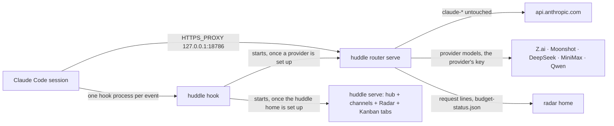

<p align="center">
  
</p>

<p align="center">
  <a href="https://github.com/MuhmdRaouf/huddle/actions/workflows/ci.yml"></a>
  <a href="LICENSE"></a>
  <a href="https://modelcontextprotocol.io"></a>
  <a href="https://code.claude.com/docs/en/plugins"></a>
</p>

<p align="center">
  <a href="https://github.com/sponsors/MuhmdRaouf"></a>&nbsp;&nbsp;<a href="https://buymeacoffee.com/muhmdraouf"></a>
</p>

# huddle

One local hub where your AI coding sessions work as a team, from Claude Code or any agent that speaks MCP. One
static binary, one plugin, three parts:

- **The hub:** channels with shared events, tasks, messages and knowledge; every session on every machine in one
  list, what needs you first, approvals from your phone with a passkey; `/huddle:statusline` puts channel, spend
  and plan limits in the status bar.
- **Radar:** requests, input and output tokens, cost and health per session, model, project and agent CLI, with
  graphs. No tokens spent to watch.
- **Kanban:** a board per repository that sessions claim cards from and move through review and testing.

The same repository ships the five provider plugins — `zai`, `kimi`, `deepseek`, `minimax` and `qwen` — thin
Claude Code plugins that run GLM, Kimi, DeepSeek, MiniMax and Qwen models through the one router this binary
serves, and delegate verified background jobs to them. Each has its own README under
[`plugins/`](plugins/zai-plugin-cc/README.md).

## Find what you need

| I want to… | Start here |
|---|---|
| Install Huddle | [Quick start](#quick-start) |
| Check the requirements | [Requirements](#requirements) |
| Sign in, with a code, a passkey or a phone | [Signing in](#signing-in) |
| Read costs and requests | [Radar](#radar) |
| Work a kanban board from sessions | [Kanban](#kanban) |
| Connect Codex, Gemini, Qwen, opencode, crush, omp or pi | [Other agents](#other-agents) |
| Run a hub on a local name | [A local name](#a-local-name) |
| Develop on Huddle | [Development](#development) · [Test plan](docs/TESTPLAN.md) · [Decisions](docs/DECISIONS.md) |

## Quick start

1. Add the marketplace and install the plugin in Claude Code:

   ```text
   /plugin marketplace add MuhmdRaouf/huddle
   /plugin install huddle@muhmdraouf
   ```

2. Restart Claude Code.
3. Run `/huddle:setup` in any project. It names the channel and this session after the project folder, joins the
   project to it, starts the hub and prints the dashboard link — it signs you in once, within 5 minutes.

To delegate work to a provider model, install its plugin the same way (`/plugin install zai-plugin-cc@muhmdraouf`)
and run its `/zai:setup` — installing the plugin installs `huddle` with it. While no release is published, the
launcher builds the binary of the marketplace checkout's own commit with `go` (see
[Requirements](#requirements)).

That is all: the hooks start the hub — with Radar and the board living inside it — and, once a provider is set
up, huddle-router beside it as a second process, and bring each back on the next hook after a crash or a reboot.

## Two processes: the router and the hub

Each user runs at most one router and one hub, each its own process, and a second start of either finds the first
and exits 0 ([ADR-4](docs/adr/0004-router-process.md)).

- **huddle-router:** `huddle router serve` holds 127.0.0.1:18786 for Claude Code's model requests. It runs as soon
  as a provider plugin is set up, with or without a huddle home.
- **The hub:** `/huddle:setup` ran. `huddle serve` serves channels, the Now list and the dashboard with its Radar
  and Kanban tabs. A hub restart, update or crash never touches the router, so the Claude streams in flight keep
  going.

`huddle up` starts the router, then the hub, and prints both pids; `huddle status` and the hub's `/health` name
both.



Each session's `huddle mcp` bridge watches the router: a health check every 2 s, a restart after 5 s of silence.

A provider lane can name fallback models in `providers.json`
(`"lanes": {"zai": {"fallback": ["glm-5.3-flash"]}}`): after three 5xx, 429 or dropped answers in a row for one
model, its requests go to the next model on the list for 60 s, the router logs the switch, and Radar's Requests
table marks the request ([USAGE · Delegate to a provider model](docs/USAGE.md#delegate-to-a-provider-model)).

## Requirements

- Claude Code with plugin support.
- macOS or Linux, on amd64 or arm64: one static binary, no JS runtime. No release is published yet, so the
  launcher (`plugin/dist/run`, the same script every plugin ships) builds the binary of the marketplace checkout's
  own commit: once per commit, with `go` (`$HUDDLE_SOURCE`, the checkout the plugin was installed from, or the
  marketplace copy under `CLAUDE_CONFIG_DIR` names the sources), kept three builds to a home. A command waits up
  to 5 minutes for that build; a hook starts it detached and exits 0. On macOS the build is signed ad hoc as
  `huddle`, so the firewall prompt names huddle. Without Go the launcher says so: it names
  the release download it cannot fall back to and the line `no huddle release is published; install Go to build
  it from the marketplace checkout`. A release download, when one exists, is checked against the committed
  manifest (`release/v<VERSION>.json`).
- Developing on Huddle also needs Go and Bun 1.3 or later — see [Development](#development).

## The plugin

Ten slash commands, one product:

| Command | What it does |
|---|---|
| `/huddle:setup` | Set up Huddle on this machine and join this project to a channel |
| `/huddle:invite` | Make a join line that brings another Claude session into this Huddle |
| `/huddle:join` | Join a Huddle with the join line `/huddle:invite` showed |
| `/huddle:open` | Ensure the hub is running and print its dashboard URL (Now, Radar and Kanban tabs) |
| `/huddle:status` | One table: hub, radar, gateway; running or not, address |
| `/huddle:stop` | Stop the hub this user started; radar and the boards are served by it |
| `/huddle:kanban-init` | Create this project's kanban board, or migrate an old backlog board into it |
| `/huddle:kanban-lint` | Check every ticket against the bar; exit 1 when any fails |
| `/huddle:kanban-refresh` | Rescan the board now and reload every open board page |
| `/huddle:kanban-export` | Write the board as one self-contained HTML page for sharing |

The hooks start the servers, so there is nothing to start by hand: each event runs one hook process, and huddle's,
radar's, kanban's and the providers' parts ride inside it — the five provider plugins ship no hooks of their own.
Claude Code's agent teams show too: the `TaskCreated` hook says a new task on the session's channel as
`task: <subject>` and adds it to the project's board as one card `CC-<id>` in cluster `cc tasks`, and the
`TeammateIdle` hook lists the teammate under its lead in the hub's Now list with the word idle.
A service manager (launchd, systemd) or a terminal can also run
`huddle serve`: the server leaves its owner credential in the home's `run/owner.key`, and `huddle open` on the
same machine still signs the owner in.

Invites: a session's join line from `/huddle:invite` lives 24 h (`--ttl` changes it, `--single-use` spends it
once), a satellite invite from `huddle pair --satellite` is one use and lives 10 minutes, and a spent or made-up
token is refused.

## Signing in

Four ways in, one hub:

1. **Authenticator code** (the primary): set it up once — the first link sign-in offers it, or Settings → Sign-in
   any time after — by scanning the QR with your authenticator app (Google Authenticator, 1Password, Authy). Every
   later visit is six digits. `huddle totp setup` does the same from a terminal; `huddle totp off` removes it.
   Five wrong codes in 5 minutes lock code sign-in for 15 minutes.
2. **Recovery codes**: ten one-time codes the set-up shows once. Each signs in like a code when the app is not at
   hand; Settings → Sign-in can re-enrol for a fresh set.
3. **Passkey** (optional extra): after a code sign-in the page offers to save this browser's lock (Touch ID, Face
   ID, fingerprint) as a passkey — "Not now" asks again in 30 days, and the code keeps working either way.
   `huddle pair` pairs another device.
4. **Sign-in link**: `huddle open`, or `/huddle:setup` in a session, always prints a fresh one-time link as the
   fallback. It lives 5 minutes: loopback on a solo machine, the hub's own https address on a hub.

A device session ends after 7 days unused; removing it from Settings ends it at once. See the [guide](docs/USAGE.md).

## Radar

- Every request with its model, latency, input, output, cache-read and cache-write tokens and its cost, fed by
  hooks, transcripts and the routers' spool. Watching spends no tokens.
- Eleven views in the Radar tab: Overview, Costs, Models, Usage, Blocks, Requests, Tools, Agents, Routers, Alerts,
  Timeline. Blocks follows the active 5-hour metering window; Usage splits tokens and cost by model, project and
  agent. Radar's settings live in Settings › Hub and Radar.
- Budgets stop and lift from Settings — on a hub, from a paired phone. A stopped budget lands in
  `budget-status.json`, which huddle-router reads before serving a provider model: the provider's models answer
  with the budget refusal while its scope, or `total`, is stopped, and `claude-*` is never touched.

## Kanban

- One board per repository (`.agents/kanban/kanban.db`): sessions claim cards, and the first claim wins — every
  other pull, from either machine, gets the board's refusal. `new` stays local: a ticket is written to the clone
  the session sits in, never through the hub.
- A session in a git worktree works its main checkout's board, unless the worktree holds an `.agents/kanban` of
  its own.
- A board's key is its repository's origin, so every clone of one repository names one board. Join a second
  machine with `huddle pair --satellite` on the hub and `huddle join-hub` on the other machine: its claims and
  moves relay to the hub, which holds the one database and the audit.
- The hub away, a satellite changes nothing: a claim needs the hub's answer and is never queued. Both machines'
  Kanban tabs show the hub's board with its live event stream; a satellite's tab falls back to its local copy.

## Other agents

Huddle's MCP server works with any harness that speaks MCP. For seven of them the binary wires itself in:

```sh
huddle harness list              # what is on this machine: installed, available or absent
huddle harness install <name>    # add huddle's MCP server, and the harness's own lifecycle
                                 # hooks where it has them, to the harness's config
huddle harness remove <name>     # take both out again, the config back to its previous bytes
```

The names: `codex` (Codex CLI), `gemini` (Gemini CLI), `qwen` (Qwen Code), `opencode`, `crush`, `omp`
(oh-my-pi), `pi` and `zcode` (the ZCode CLI). Every change
is recorded in `$HUDDLE_HOME/harness-ledger.json` and undone exactly by `remove`; an entry you edited by hand
stays, and remove says so. Install also wires each harness's own hooks (omp, pi and zcode get none), so its sessions sit in the hub's Now
list next to Claude Code's, badged by agent. A hook never blocks: it posts to the local hub and answers in
silence, inside a short deadline.

| Harness | MCP | Model traffic |
|---|---|---|
| `codex` | `[mcp_servers.huddle]` in `~/.codex/config.toml` (`$CODEX_HOME` moves it) | An opt-in `[model_providers.huddle]`: `codex -c model_provider=huddle` sends the Responses API to `http://127.0.0.1:18786/gateway/v1` with your `OPENAI_API_KEY`, named `codex` in radar. Plain HTTP on loopback, so no CA; your default provider and `openai_base_url` stay as they are |
| `opencode` | `mcp.huddle` in `~/.config/opencode/opencode.json` (`$XDG_CONFIG_HOME` moves it), with a 120 s request timeout so a `wait` outlasts its long poll | `provider.anthropic.options` in the same file: `baseURL` `http://127.0.0.1:18786/gateway/v1` and the header `X-Huddle-Harness: opencode`, so opencode's Anthropic requests go through the router with your own key, named `opencode` in radar. Plain HTTP on loopback, so no proxy and no CA. An `opencode.json` that already configures `anthropic` is left as it is, and install says so |
| `omp` | `mcpServers.huddle` in `~/.omp/agent/mcp.json` (`$PI_CODING_AGENT_DIR` or `$PI_CONFIG_DIR` moves it), which omp reads before the servers it imports from Claude Code or Codex | `providers.anthropic` in `~/.omp/agent/models.yml`, between `# huddle:begin` and `# huddle:end`: `baseUrl` `http://127.0.0.1:18786/gateway` and the header `X-Huddle-Harness: omp`, so omp's Anthropic requests go through the router with your own key or login, named `omp` in radar. Plain HTTP on loopback, so no proxy and no CA. A `models.yml` that already configures `anthropic` is left as it is, and install says so |
| `pi` | `mcpServers.huddle` in `~/.pi/agent/mcp.json` (`$PI_CODING_AGENT_DIR` moves it), with a 120 s request timeout so a `wait` outlasts its long poll; pi runs it ahead of any extension's server of the same name | `providers.anthropic` in `~/.pi/agent/models.json`: `baseUrl` `http://127.0.0.1:18786/gateway` and the header `X-Huddle-Harness: pi`, so pi's Anthropic requests go through the router with your own key, named `pi` in radar; pi's own anthropic models stay listed. Plain HTTP on loopback, so no proxy and no CA. A `models.json` that already configures `anthropic` is left as it is, and install says so |
| `zcode` | `mcp.servers.huddle` in `~/.zcode/cli/config.json`, with a 120 s request timeout so a `wait` outlasts its long poll | Two rules in `~/.zcode/v2/provider_config.json` (`$ZCODE_PERSONAL_PROVIDER_CONFIG_FILE` moves it) for the Z.ai Coding Plan providers, individual and team: `baseUrl` `http://127.0.0.1:18786/gateway` and the header `X-Huddle-Harness: zcode`, so zcode's GLM requests go through the router to Z.ai with your own login, named `zcode` in radar. Plain HTTP on loopback, so no proxy and no CA. The start, off-peak, highspeed and BigModel plans speak other upstreams and stay direct. A rule you already keep for either plan is left as it is, and install says so |

### The MCP surface

A channel is a standard MCP pub/sub surface, so an agent can watch it without polling in a loop. The server
speaks Streamable HTTP at `/mcp/<channel>` and stdio through `huddle mcp`:

- `resources/list` names `huddle://<channel>/events` and one `huddle://<channel>/topic/<topic>` per recent topic.
- `resources/read` returns the events as one JSON array; `?after=<seq>` reads only what follows a cursor (100 max).
- `resources/subscribe` gets `notifications/resources/updated` on every event; subscriptions end with the session.
- The `poll` tool long-polls for harnesses without subscriptions: `after`, `topics` (globs), `timeout_ms` (max 60000).

Identify a session with `HUDDLE_SESSION`; no Claude Code variable is needed. See the [guide](docs/USAGE.md).

## The gateway

The huddle-router daemon serves a gateway under `/gateway` that speaks the Anthropic Messages API and the
OpenAI Chat Completions and Responses APIs. Point a harness's base URL at it and every request goes to the
upstream its model's route names, unchanged, while radar records the model, latency and tokens. Name your
upstreams in `$HUDDLE_HOME/gateway.json`; a model goes to the longest glob that matches it, anything else to
its API family's default, which is the API's own host (`https://api.anthropic.com`, `https://api.openai.com`)
when the file names none. A GLM model (`GLM-*` or `glm-*`) on the Anthropic route that no route names goes to
Z.ai's `https://api.z.ai/api/anthropic`:

```json
{
  "routes": [{"match": "glm-*", "upstream": "https://api.z.ai/api/anthropic"}],
  "anthropic": "https://api.anthropic.com",
  "openai": "https://api.openai.com"
}
```

A request is forwarded byte for byte with its headers (authentication included — the gateway adds nothing and
keeps nothing but the route line's metadata). `huddle router start` runs the daemon the gateway rides on, and
`huddle gateway status` answers the address — `http://127.0.0.1:18786/gateway` when the router keeps its
canonical port. A client can identify itself with `X-Huddle-Harness`, which lands on the route line
next to `via: gateway`, so radar tells the harnesses apart.

## A local name

A hub on a local name (`hub.example.dev`, pointed at your machine by dnsmasq or `/etc/hosts`) cannot get a
Let's Encrypt certificate without a public DNS token, so huddle keeps its own local CA: a 10-year root and
12-hour leaves, renewed at two thirds of their life. A public name gets its certificate over ACME DNS-01.

1. Point the name at this machine: dnsmasq, or one line in `/etc/hosts`.
2. Run `huddle role hub --listen 127.0.0.2:8443 --host hub.example.dev`.
3. Run `huddle trust` once. It installs huddle's root (`<home>/pki/root.crt`) into your OS's and Firefox's trust
   stores; your OS asks for your password itself. `huddle untrust` removes it again.
4. Open `https://hub.example.dev:8443`.

Already hold a pair (mkcert, a company CA)? `huddle cert --import cert.pem key.pem` installs it and the hub
serves it instead (`huddle cert` says which). It is never renewed; the log names its expiry from 30 days out.

Behind Caddy on this machine, run `/huddle:domain hub.example.dev` (or `huddle domain hub.example.dev` in a
terminal). It sets the hub's name with no listener of its own and prints the site block to paste into your
Caddyfile:

```text
hub.example.dev {
    reverse_proxy 127.0.0.1:18860 {
        header_up X-Forwarded-Proto https
    }
}
```

1. Paste the block and reload Caddy. Caddy gets the certificate from Let's Encrypt; a private name
   (`hub.example.test`) gets `tls internal` in the block, and `caddy trust` once makes browsers accept it.
2. Restart huddle. The hub keeps answering loopback only, and `huddle open` prints
   `https://hub.example.dev/?code=…`; a sign-in Caddy forwards from https gets a `Secure` cookie.
3. Run `/huddle:domain --check`. It asks `https://hub.example.dev/health` (3 s, no proxy) and says whether Caddy
   reaches this hub. Nothing else in huddle touches the network for the name.

`/huddle:domain` alone shows the name, and `/huddle:domain off` goes back to localhost only, the default of a
fresh install. The long form of the same role is `huddle role hub --host hub.example.dev`. The role pins the
hub's port (18860, or the one already saved) so the proxy always finds it: when another program holds it,
`huddle up` exits 2 instead of moving to another port.

## Use Huddle on your phone

The dashboard is a PWA that signs in with a passkey, so a phone works as the needs-you screen:

1. Run `huddle trust --phone` on the computer and scan the QR with the phone's camera: the page it opens
   downloads the root, shows the exact taps for iOS and Android, and the fingerprint to compare with the
   terminal's. It serves for 10 minutes and installs nothing on the computer.
2. Open the hub's address in the phone's browser and add it to the home screen.
3. Run `huddle pair --name phone` on the computer, scan that QR, check the code matches and create the passkey.
4. Turn on Face ID (or the Android equivalent) when the browser offers it: one glance answers an approval.

Settings → Phone has an "Add a phone" button that shows the same QR in a sheet.

## Update

- Run `/plugin marketplace update huddle`, then restart Claude Code.

## Uninstall

- Run `/plugin uninstall huddle@muhmdraouf`, after `huddle harness remove <name>` for every harness you wired.
- A server still running stops itself, removes its run files (nothing you wrote: pid, port, log, the owner key)
  and leaves `LEFT-BEHIND.md` in the home naming where the channels are and how to delete them.
- The channels stay in the Huddle home (`$HUDDLE_HOME`, else `$XDG_CONFIG_HOME/huddle`, else `~/.config/huddle`)
  under `data/channels/`, and each project's `.agents/huddle/huddle.json` is left as it is.
- After uninstalling, run `/plugin marketplace remove huddle`.

## Development

Install the pinned tools once, from the repository root: `mise run setup`.

| Check or build | Command from the repository root |
|---|---|
| Every gate CI runs | `mise run check` |
| The Go suite (hermetic, temp homes) | `go run ./scripts/tmpguard -count=1 ./...` |
| The web workspaces (ui, hub, kanban) | `bun install && bun run check` |
| The headless-browser e2e suite | `bun run e2e` |
| Rebuild every page and the launcher | `bun run build` |
| The release binaries, the manifest the launcher pins, and the pre-tag digest check | `go run ./scripts/build -out dist` · `go run ./scripts/build -manifest` · `go run ./scripts/build -check` |
| Load the plugin from the working tree | `claude --plugin-dir ./plugin` |
| No AI attribution in the history | `node scripts/check-attribution.mjs` |

CI (`.github/workflows/ci.yml`) runs the same gates on every push; every job is capped at 10 minutes. The built
pages and the launcher are committed, so installs need no build step. [AGENTS.md](AGENTS.md) has the commit
rules, [CHANGELOG.md](CHANGELOG.md) lists each release, and [docs/TESTPLAN.md](docs/TESTPLAN.md) maps every
feature to the test that proves it.
- Bugs and ideas: [open an issue](https://github.com/MuhmdRaouf/huddle/issues).

## Security

- Report security problems privately through [GitHub security advisories](https://github.com/MuhmdRaouf/huddle/security/advisories/new); never open a public issue.

## Trademarks

- This is an independent project, not affiliated with or endorsed by Anthropic or any other company named here.
- Claude and Claude Code are trademarks of Anthropic, PBC.
- Codex, Gemini, Qwen, opencode and crush belong to their owners, named only to say what Huddle works with.

## Support

<p align="center">
  If Huddle makes your day easier, say thanks here:
</p>

<p align="center">
  <a href="https://github.com/sponsors/MuhmdRaouf"></a>&nbsp;&nbsp;<a href="https://buymeacoffee.com/muhmdraouf"></a>
</p>

## License

[GPL-3.0-or-later](LICENSE). Copyright © 2026 [Raouf](https://github.com/MuhmdRaouf).
