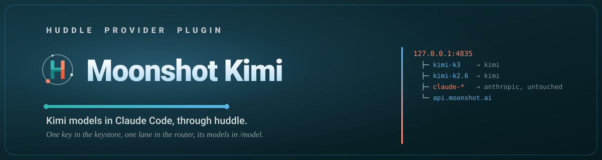

<p align="center">
  
</p>

<p align="center">
  <a href="https://www.gnu.org/licenses/gpl-3.0"></a>
  <a href="https://code.claude.com/docs/en/plugins"></a>
  <a href="https://github.com/MuhmdRaouf/huddle/actions/workflows/ci.yml"></a>
</p>

<p align="center">Built with ❤️ for the Claude Code community.</p>

# kimi

Routes Moonshot Kimi models through huddle-router inside Claude Code. Pick
`kimi-k3` or `kimi-k2.6` in `/model`, or hand work to their agents by name; every
`claude-*` request still reaches Anthropic untouched.

This plugin depends on [`huddle`](../../plugin/README.md): install it first,
run `/huddle:setup` and restart Claude Code once.

## Commands

| Command | What it does |
|---|---|
| `/kimi:setup` | Check the key with Moonshot, add the `kimi-*` lane to huddle-router and the models to `/model` |
| `/kimi:usage` | Requests, tokens and estimated cost per model, today and the last 7 and 30 days |
| `/kimi:board` | What delegated jobs are doing now |
| `/kimi:review` | Review a delegated job and accept it or return it with feedback |
| `/kimi:remove` | Take the lane, the `/model` entries and the stored key back out |

## Models

| Model | Agent | Upstream |
|---|---|---|
| `kimi-k3` | `kimi:kimi-k3` | `api.moonshot.ai` |
| `kimi-k2.6` | `kimi:kimi-k2.6` | `api.moonshot.ai` |

## Quick start

1. Install huddle and this plugin:

   ```text
   /plugin install huddle@muhmdraouf
   /huddle:setup
   /plugin install kimi-plugin-cc@muhmdraouf
   ```

2. Restart Claude Code once, if `/huddle:setup` asked for it.
3. Get a key from [Moonshot](https://platform.kimi.ai/console/api-keys). Then run `/kimi:setup`.
4. Pick `kimi-k3` in `/model`.

## Key

The key comes from `KIMI_API_KEY`, `~/.config/kimi-plugin-cc/env` or
`huddle provider kimi key`, which reads hidden stdin. It is stored in the OS
keystore: the macOS Keychain, or the Secret Service on Linux. It never travels
in a chat, an argument or an output line. The huddle dashboard shows whether a
key is stored, never the key.

## Remove

Run `/kimi:remove`, then `/plugin uninstall kimi-plugin-cc@muhmdraouf`. The other
providers keep serving.

## License

[GPL-3.0-or-later](LICENSE).
