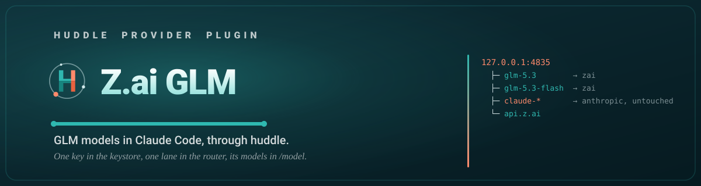

<p align="center">
  
</p>

<p align="center">
  <a href="https://www.gnu.org/licenses/gpl-3.0"></a>
  <a href="https://code.claude.com/docs/en/plugins"></a>
  <a href="https://github.com/MuhmdRaouf/huddle/actions/workflows/ci.yml"></a>
</p>

<p align="center">Built with ❤️ for the Claude Code community.</p>

# zai

Routes Z.ai GLM models through huddle-router inside Claude Code. Pick
`glm-5.3` or `glm-5.3-flash` in `/model`, or hand work to their agents by name; every
`claude-*` request still reaches Anthropic untouched.

This plugin depends on [`huddle`](../../plugin/README.md): install it first,
run `/huddle:setup` and restart Claude Code once.

## Commands

| Command | What it does |
|---|---|
| `/zai:setup` | Check the key with Z.ai, add the `glm-*` lane to huddle-router and the models to `/model` |
| `/zai:usage` | Requests, tokens and estimated cost per model, today and the last 7 and 30 days |
| `/zai:board` | What delegated jobs are doing now |
| `/zai:review` | Review a delegated job and accept it or return it with feedback |
| `/zai:remove` | Take the lane, the `/model` entries and the stored key back out |

## Models

| Model | Agent | Upstream |
|---|---|---|
| `glm-5.3` | `zai:glm-5.3` | `api.z.ai` |
| `glm-5.3-flash` | `zai:glm-5.3-flash` | `api.z.ai` |

## Quick start

1. Install huddle and this plugin:

   ```text
   /plugin install huddle@muhmdraouf
   /huddle:setup
   /plugin install zai-plugin-cc@muhmdraouf
   ```

2. Restart Claude Code once, if `/huddle:setup` asked for it.
3. Get a key from [Z.ai](https://z.ai/manage-apikey/apikey-list). Then run `/zai:setup`.
4. Pick `glm-5.3` in `/model`.

## Key

The key comes from `ZAI_API_KEY`, `~/.config/zai-plugin-cc/env` or
`huddle provider zai key`, which reads hidden stdin. It is stored in the OS
keystore: the macOS Keychain, or the Secret Service on Linux. It never travels
in a chat, an argument or an output line. The huddle dashboard shows whether a
key is stored, never the key.

## Remove

Run `/zai:remove`, then `/plugin uninstall zai-plugin-cc@muhmdraouf`. The other
providers keep serving.

## License

[GPL-3.0-or-later](LICENSE).
